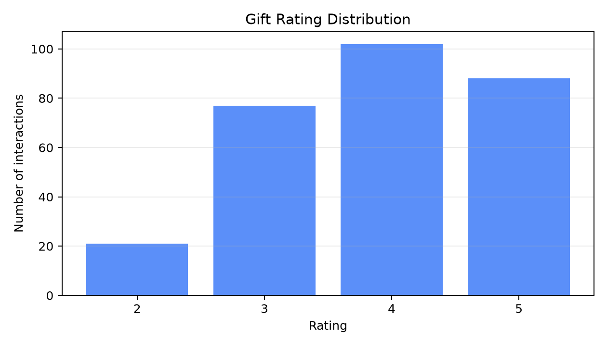
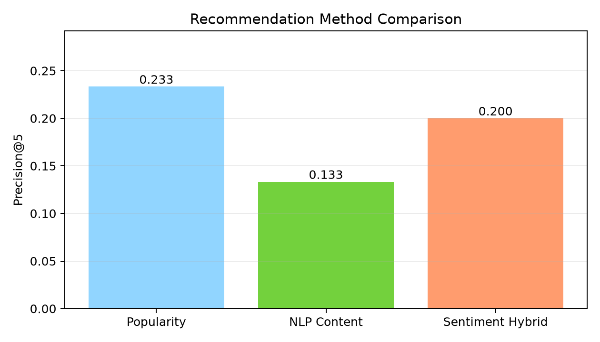

# Gift Idea and Occasion Recommender

**Student:** Tran Thi Quynh Nhu  
**Student ID:** 29201362444  
**Section:** CS467C (No. 12)  
**Instructor:** Puri Vikram  
**Project code:** MP-C12

## 1. Problem Statement

Shoppers often know a recipient's hobbies and the occasion but need help selecting a suitable gift. This project combines an NLP text pipeline with three recommendation approaches to help users discover gifts from an occasion/query, find alternatives to a known gift, or add and discover a seasonal item with no interaction history.

## 2. Dataset

- `data/items.csv`: 40 realistic gifts with `item_id`, `gift_name`, `price_range`, `occasion_tags`, `description`, and `recipient_tags`.
- `data/ratings.csv`: 12 buyers and 288 interactions. Every user rated exactly 24 of the 40 items.
- Missing ratings: 192 / 480 = 40%, producing a sparse but realistic 60% observed / 40% missing user-item matrix.
- Each interaction has a rating from 1 to 5 and a varied buyer review.
- The data is synthetic and designed specifically for this assignment; no public dataset was adapted.

Use `python generate_data.py` to regenerate the deterministic CSV files.

## 3. NLP Pipeline

`src/nlp_pipeline.py` performs lowercasing, punctuation removal, whitespace normalization, tokenization, stop-word removal, and unigram/bigram TF-IDF extraction over gift names, descriptions, occasion tags, and recipient tags.

The same fitted `TfidfVectorizer`:

- transforms free-text queries,
- vectorizes item descriptions,
- supports item-to-item similarity, and
- supplies top weighted matching keywords for explanations.

Buyer reviews are scored with a small lexicon:

`sentiment = (positive words - negative words) / number of tokens`

The result is clipped to [-1, 1] and then aggregated by item.

## 4. Recommendation Methods

1. **Popularity baseline:** weighted popularity is `mean_rating * log1p(rating_count)`, with a minimum of 2 ratings. Items rated by the target user are removed.
2. **NLP content-based recommender:** cosine similarity over TF-IDF vectors. A user profile is the weighted sum of vectors for the user's rated items. Free-text queries are transformed with the existing fitted vocabulary.
3. **Sentiment-aware hybrid:**  
   `0.45 * TF-IDF similarity + 0.25 * average review sentiment + 0.30 * popularity`

Cosine similarity is used for text matching:

`cos(a, b) = (a . b) / (||a|| * ||b||)`

The hybrid applies min-max normalization to the content and popularity components.

## 5. Installation and Run

Requires Python 3.10 or newer.

```bash
python -m venv .venv
.venv\Scripts\activate
pip install -r requirements.txt
python src/main.py
```

Run a custom free-text query:

```bash
python src/main.py --query "thoughtful handmade birthday gift for tea lover"
```

Run recommendations for an existing user:

```bash
python src/main.py --user U01
```

Find alternatives for an item:

```bash
python src/main.py --similar G001
```

## 6. Required Test Cases

### Test 1: Occasion query

Query: `thoughtful handmade birthday gift for tea lover`

1. Gourmet Tea Sampler (G025) — score 0.8209
2. Artisan Ceramic Tea Set (G001) — score 0.6973
3. Board Game Night Set (G015) — score 0.5754
4. Handmade Scented Soy Candle (G003) — score 0.5430
5. Retro Instant Camera (G029) — score 0.5137

### Test 2: Similar-gift alternatives

Selected bestseller: **Garden Tool Apron (G030)**

1. Handmade Woven Basket (G039) — score 0.1366
2. Bamboo Bath Spa Set (G012) — score 0.0838
3. Digital Recipe Tablet Stand (G021) — score 0.0806
4. Yoga Gift Bundle (G028) — score 0.0770
5. Indoor Herb Garden (G017) — score 0.0712

### Test 3: Cold-start item

A brand-new `G041 Seasonal Handmade Tea Advent Calendar` was added with description and tag text only. It was refitted into the TF-IDF vocabulary and became the top discovery result for `handmade tea holiday gift for tea lover`.

1. Seasonal Handmade Tea Advent Calendar (G041) — score 0.5176
2. Gourmet Tea Sampler (G025) — score 0.3173
3. Artisan Ceramic Tea Set (G001) — score 0.2622
4. Personalized Birth Flower Mug (G002) — score 0.1603
5. Board Game Night Set (G015) — score 0.0941

The complete saved output is in `results/sample_outputs.txt`.

## 7. Offline Evaluation

A deterministic 20% holdout split hides approximately 5 ratings per user. Precision@5 counts held-out items rated 4 or 5 as relevant. RMSE and MAE use item-mean rating prediction, with user-mean and global-mean fallbacks.

| Method | Precision@5 | MAE | RMSE |
|---|---:|---:|---:|
| Popularity baseline | 0.2333 | 0.7031 | 0.9425 |
| NLP content-based | 0.1333 | — | — |
| Sentiment-aware hybrid | 0.2000 | — | — |
| Rating predictor | — | 0.7031 | 0.9425 |

### Charts

**Rating distribution**



**Precision@5 comparison**



## 8. Project Structure

```text
data/
  items.csv
  ratings.csv
src/
  nlp_pipeline.py
  recommender.py
  evaluate.py
  main.py
results/
  sample_outputs.txt
  rating_distribution.png
  method_comparison.png
README.md
requirements.txt
.gitignore
```

## 9. Reflection

TF-IDF and cosine similarity are easy to explain and work well for occasion and recipient-language matching. The cold-start test demonstrates that a newly added textual item can immediately be discovered by refitting TF-IDF. The lexicon sentiment feature provides a lightweight review-quality signal, but review text is small and synthetic, and a fixed word list will miss context and negation.

Limitations include the small dataset, random synthetic interactions, no true temporal split, and no collaborative filtering model. A larger real dataset could improve evaluation stability and enable cross-validation or learned ranking.
